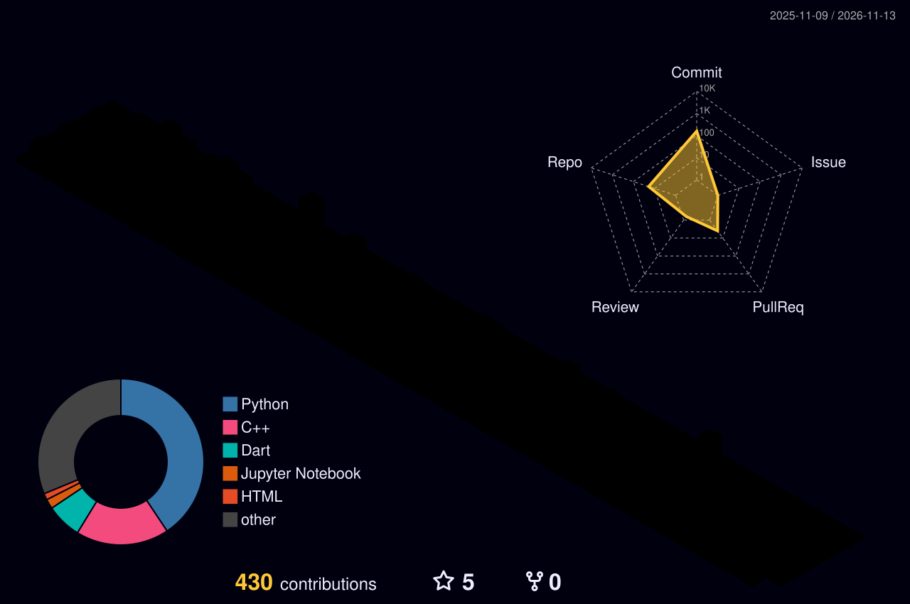

  

 

 

  

 

<h2 align="center">What I Work On</h2>

<table>
<tr>
<td width="25%" align="center" valign="top">
 
<b>Agents & MCP</b> 
Tool-calling agents, JSON-RPC servers, deterministic evaluation
</td>
<td width="25%" align="center" valign="top">
 
<b>RAG Systems</b> 
Chunking, embeddings, vector search, grounded answers
</td>
<td width="25%" align="center" valign="top">
 
<b>Computer Vision</b> 
Labeling to deployment, models that run on live traffic
</td>
<td width="25%" align="center" valign="top">
 
<b>Data Engineering</b> 
Clean pipelines, warehouses, data that models can trust
</td>
</tr>
</table>

 

<h2 align="center">By the Numbers</h2>

  

 

<h2 align="center">Things I've Built</h2>

<table>
<tr>
<td width="50%" valign="top">

#### MCP Agent Lab
A coding agent that explores a repo, edits files, runs tests and reads diffs, all through MCP tool calls. Separate verifier and golden reference, so the score can't be faked.

`Python` `MCP` `JSON-RPC` `pytest`

</td>
<td width="50%" valign="top">

#### OperIQ
An assistant that plugs into company documents and databases, then answers questions and breaks down reports. RAG for knowledge, MCP for actions.

`FastAPI` `React` `Azure OpenAI` `Vector DB`

</td>
</tr>
<tr>
<td width="50%" valign="top">

#### Listing Image Classifier
Screens property photos as they're uploaded. Trained on 58K images I labeled and cleaned myself, then shipped it into a live moderation flow.

`PyTorch` `CVAT` `OpenCV`

</td>
<td width="50%" valign="top">

#### AfriCogniBench
An 1,800-item benchmark that checks whether AI models know what they don't know. Built for Kaggle's *Measuring Progress Toward AGI*.

`Benchmark Design` `Evaluation`

</td>
</tr>
<tr>
<td width="50%" valign="top">

#### Fleet Risk Radar
Turns 336K flight records into early warnings for maintenance. Anomaly detection plus Random Forest, on a Snowflake warehouse with Power BI on top.

`Scikit-learn` `Snowflake` `MLflow` `Power BI`

</td>
<td width="50%" valign="top">

#### AI for Farms
**Avocado AI** gives smallholder farmers crop and disease advice in chat. **Girinka AI** forecasts cattle health for Rwanda's One Cow per Family program.

`Transformers` `NLP` `Time-Series`

</td>
</tr>
</table>

 

<h2 align="center">In the Arena</h2>

 

 

<h2 align="center">Toolbox</h2>

  
   
  
    
  
  
  
  
  
  
  

 

<h2 align="center">Live Activity</h2>

 

<h3>Got an AI problem worth solving? Let's talk.</h3>

  

